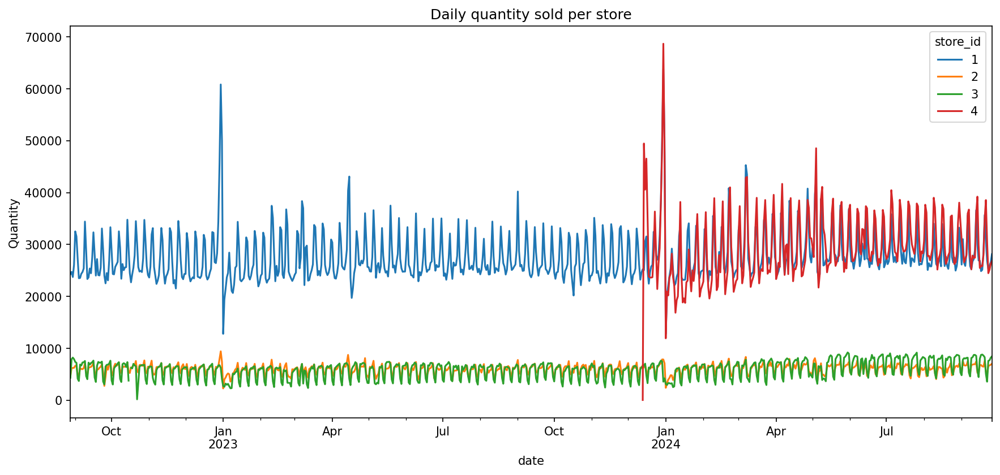
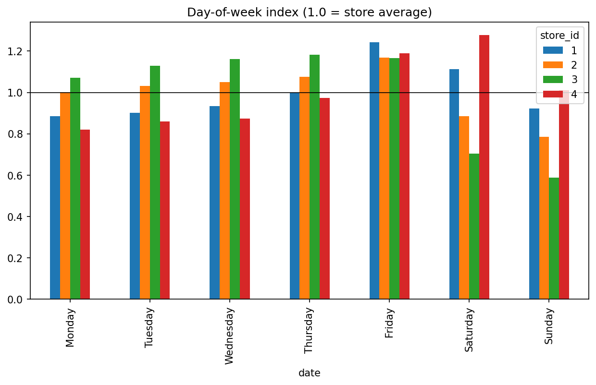
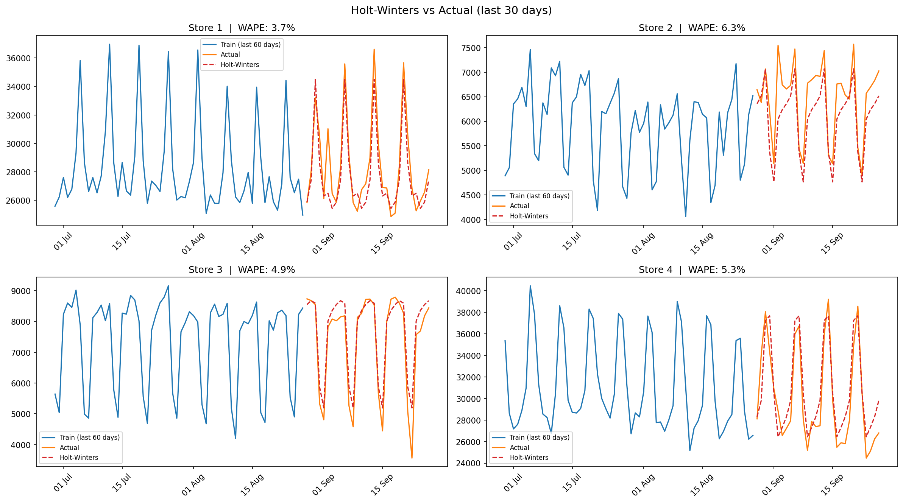
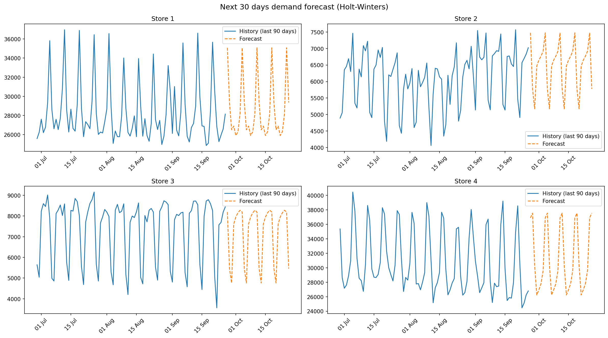

# 🛒 Retail Demand Forecasting: 30-Day Store-Level Forecast

Forecasting daily demand (units sold) for 4 supermarket stores for the next 30 days using Python.
The project compares simple baselines, a classical time-series model (Holt-Winters) and machine learning (LightGBM), and turns the result into a purchasing-ready forecast.

> **Result:** Holt-Winters forecasts next-month daily demand with an average error of **5.0% (WAPE)** on a 30-day backtest, compared with **12.7%** for a naive "same as yesterday" forecast.

---

## 📌 Key Results

| | |
|---|---|
| **Final model** | Holt-Winters (additive, damped trend, weekly seasonality), one model per store |
| **Backtest period** | 28 Aug – 26 Sep 2024 (30 days, unseen by the models) |
| **Average WAPE** | **5.0%** (naive baseline: 12.7%) |
| **Worst-store WAPE** | **6.3%** (lowest worst-case error of all models) |
| **Forecast horizon** | 27 Sep – 26 Oct 2024 |

---

## 💼 Business Problem

Purchasing and replenishment decisions start with one question: **how much will we sell?**
Ordering too much ties up cash and shelf space (and creates waste for fresh products); ordering too little means empty shelves and lost sales.

Coming from a purchasing background, I built this project around the questions a buyer actually asks:
*How many units should each store expect to sell next month, day by day, and how far can that number be trusted?*

---

## 📂 Dataset

- **Source:** [Retail Sales Forecasting Data](https://www.kaggle.com/datasets/svizor/retail-sales-forecasting-data) (Kaggle)
- **7.4M sales rows**: one row = one item sold in one store on one day
- **Period:** 28 Aug 2022 – 26 Sep 2024 (~25 months)
- **4 stores**, ~28,000 items
- Product names in the catalog are in Russian, and the holiday patterns match the Russian calendar, so this appears to be a Russian supermarket chain.
- Files used: `sales.csv` (main), `catalog.csv` and `stores.csv` (investigation)

The raw data is not included in this repository (see [How to Run](#️-how-to-run)).

---

## 🔄 Workflow

1. Data loading & exploration
2. Data cleaning
3. Aggregation to daily demand per store
4. Exploratory data analysis (EDA)
5. Time-based train/test split (last 30 days held out)
6. Baseline models
7. Holt-Winters
8. Machine learning (LightGBM, 2 versions)
9. Model comparison & selection
10. Final 30-day forecast

---

## 🧹 Data Cleaning

| Issue | Action | Impact |
|---|---|---|
| Returns and data errors (negative/zero quantities, negative prices) | Removed | < 0.05% of rows |
| Packaging items: paid shopping bags (*Auxiliary Group → Paid Bags*) and a 0.01-priced item missing from the catalog that sold thousands of units per day | Removed (not real product demand) | **~7.8% of total quantity** from only ~15K rows |
| One missing day in store 3 (store likely closed) | Interpolated | 1 day |
| Store 4 opened on 13 Dec 2023, right before New Year | Store 4 modeled from 1 Feb 2024 | Avoids opening and holiday distortion |

**Why the packaging step matters:** keeping shopping bags in the data would have inflated "demand" by almost 8%, and a buyer using the forecast would have over-ordered by the same amount.

---

## 🔍 Exploratory Data Analysis



**1. Weekly seasonality is the strongest pattern in the data.**
Every store repeats the same shape every week. Simply accounting for it cut forecast error from 9–16% to 4–5%.

**2. Store formats behave very differently.**



- **Large stores peak at the end of the week:** store 1 is +24% above its average on Fridays, and store 4 is +28% on Saturdays (weekly family shopping).
- **Small stores sell most on weekdays and drop on weekends:** store 3, a 109 m² express store, is **41% below average on Sundays**. This suggests convenience / office-area shoppers.

**3. All 10 highest-sales days are holidays:**
New Year's Eve period (29–31 Dec), International Women's Day (7–8 Mar) and the Saturday before Orthodox Easter. Peak days reach up to ~2.3× a normal day. January is the weakest month in every store.

**4. Yearly pattern in store 2:** a summer dip (Jul–Aug) followed by a ~10–13% rebound in September, in both 2023 and 2024.

**5. Growth:** store 3 grew from ~5,000 to ~7,400 units/day during 2024; store 4 ramped up after opening and stabilized around 31,000.

---

## 🧪 Evaluation Method

- **Train:** 28 Aug 2022 – 27 Aug 2024 (731 days)
- **Test:** 28 Aug – 26 Sep 2024 (30 days), never seen by the models
- **Time-based split:** no random shuffling, because a forecast can never use the future to predict the past.
- **Metric: WAPE** = Σ|actual − forecast| / Σ actual.
  It is scale-independent, so stores of very different sizes can be compared, and it is easy to explain to the business ("we were off by X% of total volume").
- **No data leakage:** the ML features only use sales that are at least 30 days older than the forecast date, because that is all the information available when forecasting 30 days ahead.

---

## 🤖 Models Compared

| Model | Idea |
|---|---|
| Naive | Every future day = the last known day |
| Seasonal naive | Each day = the same weekday last week |
| Weekday average | Each day = average of the same weekday over the last 4 weeks |
| **Holt-Winters** | Exponential smoothing with level, damped trend and weekly seasonality |
| LightGBM v1 | Gradient boosting on calendar, holiday and lag features (lags ≥ 30 days) |
| LightGBM v2 | Same, but predicts the ratio to the recent sales level instead of raw units |

### Results: WAPE % (lower is better)

| Store | Naive | Seasonal naive | Weekday avg | **Holt-Winters** | LightGBM v1 | LightGBM v2 |
|---|---|---|---|---|---|---|
| 1 | 12.1 | 4.8 | 3.7 | **3.7** | 4.8 | 3.5 |
| 2 | 9.1 | 6.6 | 10.7 | **6.3** | 8.0 | 7.2 |
| 3 | 16.2 | 4.5 | 3.7 | **4.9** | 3.8 | 4.7 |
| 4 | 13.3 | 4.8 | 5.1 | **5.3** | 4.9 | 8.8 |
| **Average** | 12.7 | 5.2 | 5.8 | **5.0** | 5.4 | 6.0 |
| **Worst** | 16.2 | 6.6 | 10.7 | **6.3** | 8.0 | 8.8 |



### Why Holt-Winters

- **Lowest average error (5.0%) and lowest worst-case error (6.3%).** It was never badly wrong in any store. For purchasing, a model that is consistently ~5% off is more useful than one that is usually 3% off but sometimes 11% off.
- **No per-store cherry-picking.** Choosing a different "best" model for each store based on a single 30-day test would overfit to that month (selection bias); differences of a few tenths of a percent are mostly noise.
- **Simple, fast and explainable.**

### What the baselines revealed

The weekday average was among the best models for stable stores (1 and 3) but the worst for store 2 (10.7%), because demand rose in September and a 4-week average of a low August reacted too slowly. This shows the core forecasting trade-off between **stability** (averaging many weeks) and **responsiveness** (relying on recent weeks), which is exactly what exponential smoothing balances.

### Why machine learning did not win

- **Too little data for ML:** only 4 aggregated series (~2,300 rows). ML models usually shine with many series (for example, item-level forecasting).
- **In v1, `store` dominated feature importance:** the model mostly learned store size instead of demand patterns.
- **v2 (ratio target) fixed that** and improved stores 1 and 2, but it applied the "September uplift" learned from other stores to store 4, which has no September history, and store 4's error jumped to 8.8%.
- **Lesson:** always benchmark complex models against simple baselines.

---

## 📈 Final Forecast: 27 Sep – 26 Oct 2024

Holt-Winters was retrained on all available data (including the test period) to forecast the next 30 days.



| Store | Forecast (next 30 days) | Actual (last 30 days) | Forecast avg / day | Change |
|---|---|---|---|---|
| 1 | 857,329 | 851,970 | 28,578 | +0.6% |
| 2 | 194,178 | 194,089 | 6,473 | 0.0% |
| 3 | 215,265 | 221,583 | 7,176 | −2.9% |
| 4 | 935,741 | 901,580 | 31,191 | +3.8% |
| **Total** | **2,202,513** | **2,169,222** | | **+1.5%** |

- The full daily forecast is in [`forecast_next_30_days.csv`](forecast_next_30_days.csv).
- **Note on store 4:** during the backtest, Holt-Winters slightly over-forecast store 4's final week, so its +3.8% may be somewhat optimistic.

---

## 💡 Business Takeaways

1. **Plan replenishment by weekday and store format.** Large stores need stock built up before Friday/Saturday; small express stores need it on weekdays, with lighter weekend deliveries.
2. **Expect ~5% forecast error.** Use it as a starting point for sizing safety stock rather than ordering exactly the forecast.
3. **Holidays need their own plan.** Peak days reach up to ~2.3× normal sales, so they should be planned separately from the regular forecast.
4. **Watch for seasonal shifts.** Store 2's September rebound means a forecast based only on recent summer weeks will under-order after the holidays.
5. **Clean non-merchandise items out of demand data.** Shopping bags alone would have distorted volume by almost 8%.

---

## ⚠️ Limitations

- `quantity` mixes units and kilograms (weighted products), so store totals are a volume proxy.
- Model selection is based on a single 30-day test window.
- Forecasts are at store level; item-level ordering would need item-level forecasts.
- Sales are not the same as demand when items are out of stock, and stock data was not available.
- Holiday dates were identified manually from the EDA.

---

## 🚀 Next Steps

- Rolling-origin backtesting over several months for more reliable model selection
- Department- and item-level forecasting, where ML is expected to perform better
- A full holiday calendar as a model feature
- Ensembles (e.g. averaging Holt-Winters and LightGBM)
- Prediction intervals to size safety stock directly

---

## ▶️ How to Run

**Option 1: Kaggle (easiest)**
1. Open the [Kaggle notebook](https://www.kaggle.com/code/aziz2612/retail-sales-forecasting) and click **Copy & Edit**, or import `retail_demand_forecasting.ipynb` into a new notebook attached to the dataset.
2. Click **Run All**.

**Option 2: Locally**
1. Download the dataset from [Kaggle](https://www.kaggle.com/datasets/svizor/retail-sales-forecasting-data).
2. Install the requirements: `pip install -r requirements.txt`
3. In the notebook, set `DATA_PATH` to the folder that contains the CSV files.
4. Run all cells.

---

## 🗂️ Repository Structure

```
├── README.md
├── retail_demand_forecasting.ipynb   # full analysis
├── requirements.txt
├── forecast_next_30_days.csv         # final daily forecast per store
├── model_comparison.csv              # WAPE of every model per store
└── images/
    ├── daily_sales_per_store.png
    ├── day_of_week_index.png
    ├── backtest_holt_winters.png
    └── final_forecast.png
```

---

## 🛠️ Tools

Python · pandas · NumPy · Matplotlib · statsmodels · LightGBM · Kaggle Notebooks
