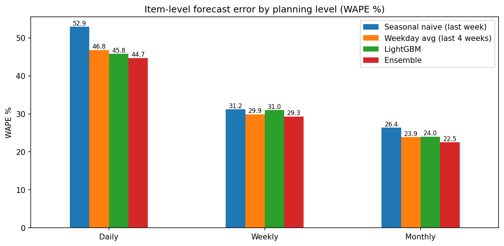
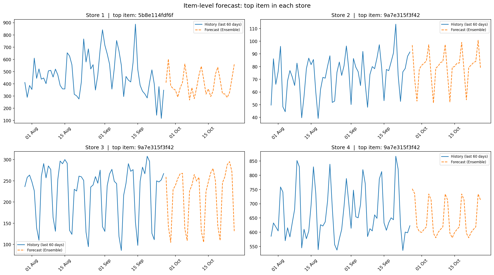

# 🛒 Retail Demand Forecasting: Store-Level & Item-Level 30-Day Forecasts

Forecasting next-month demand for a 4-store supermarket chain in Python, in two parts:

- **Part 1 – Store level:** daily units sold per store (4 series), comparing baselines, Holt-Winters and LightGBM.
- **Part 2 – Item level:** daily units for every key product (ABC class A) in every store (6,434 series), turned into a **weekly demand plan**.

> **Results:** Holt-Winters forecasts store-level demand with **5.0% error (WAPE)**. At item level, an ensemble of LightGBM and a weekday average forecasts each product's monthly demand with **22.5% error**, and beats every single model at daily, weekly and monthly level.

---

## 📌 Key Results

| | Part 1: Store level | Part 2: Item level |
|---|---|---|
| **Series forecast** | 4 stores | 6,434 item × store pairs (A items = 80% of revenue) |
| **Final model** | Holt-Winters | Ensemble (LightGBM + 4-week weekday average) |
| **Backtest period** | 28 Aug – 26 Sep 2024 | 28 Aug – 26 Sep 2024 |
| **Error (WAPE)** | **5.0%** daily | 44.7% daily · 29.3% weekly · **22.5% monthly** |
| **Naive benchmark** | 12.7% | 52.9% daily · 26.4% monthly (seasonal naive) |
| **Output** | Daily forecast per store | Weekly + monthly demand plan per item and store |
| **Forecast horizon** | 27 Sep – 26 Oct 2024 | 27 Sep – 26 Oct 2024 |

---

## 💼 Business Problem

Purchasing and replenishment decisions start with one question: **how much will we sell?**
Ordering too much ties up cash and shelf space (and creates waste for fresh products); ordering too little means empty shelves and lost sales.

Coming from a purchasing background, I built this project around the questions a buyer actually asks:
*How much will each store sell next month? Which products deserve the most planning effort? And how far can the forecast be trusted at the level orders are actually placed?*

---

## 📂 Dataset

- **Source:** [Retail Sales Forecasting Data](https://www.kaggle.com/datasets/svizor/retail-sales-forecasting-data) (Kaggle)
- **7.4M sales rows**: one row = one item sold in one store on one day
- **Period:** 28 Aug 2022 – 26 Sep 2024 (~25 months)
- **4 stores**, ~28,000 items
- Product names in the catalog are in Russian, and the holiday patterns match the Russian calendar, so this appears to be a Russian supermarket chain.
- Files used: `sales.csv` (main), `catalog.csv` and `stores.csv` (investigation), `actual_matrix.csv` (current assortment, Part 2)

The raw data is not included in this repository (see [How to Run](#️-how-to-run)).

---

## 🧹 Data Cleaning (both parts)

| Issue | Action | Impact |
|---|---|---|
| Returns and data errors (negative/zero quantities, negative prices) | Removed | < 0.05% of rows |
| Packaging items: paid shopping bags (*Auxiliary Group → Paid Bags*) and a 0.01-priced item missing from the catalog that sold thousands of units per day | Removed (not real product demand) | **~7.8% of total quantity** from only ~15K rows |
| One missing day in store 3 (store likely closed) | Interpolated (Part 1) | 1 day |
| Store 4 opened on 13 Dec 2023, right before New Year | Modeled from 1 Feb 2024 | Avoids opening and holiday distortion |

**Why the packaging step matters:** keeping shopping bags in the data would have inflated "demand" by almost 8%, and a buyer using the forecast would have over-ordered by the same amount.

---

# Part 1: Store-Level Forecast

📓 Notebook: [`01_store_level_forecast.ipynb`](01_store_level_forecast.ipynb)

## 🔍 Exploratory Data Analysis


**1. Weekly seasonality is the strongest pattern in the data.**
Every store repeats the same shape every week. Simply accounting for it cut forecast error from 9–16% to 4–5%.

**2. Store formats behave very differently.**


- **Large stores peak at the end of the week:** store 1 is +24% above its average on Fridays, and store 4 is +28% on Saturdays (weekly family shopping).
- **Small stores sell most on weekdays and drop on weekends:** store 3, a 109 m² express store, is **41% below average on Sundays**. This suggests convenience / office-area shoppers.

**3. All 10 highest-sales days are holidays:**
New Year's Eve period (29–31 Dec), International Women's Day (7–8 Mar) and the Saturday before Orthodox Easter. Peak days reach up to ~2.3× a normal day. January is the weakest month in every store.

**4. Yearly pattern in store 2:** a summer dip (Jul–Aug) followed by a ~10–13% rebound in September, in both 2023 and 2024.

**5. Growth:** store 3 grew from ~5,000 to ~7,400 units/day during 2024; store 4 ramped up after opening and stabilized around 31,000.

## 🧪 Evaluation Method (both parts)

- **Train:** 28 Aug 2022 – 27 Aug 2024 · **Test:** 28 Aug – 26 Sep 2024 (30 days), never seen by the models
- **Time-based split:** no random shuffling, because a forecast can never use the future to predict the past.
- **Metric: WAPE** = Σ|actual − forecast| / Σ actual.
  It is scale-independent (stores and products of very different sizes can be compared), it handles days with zero sales (unlike MAPE), and it is easy to explain ("we were off by X% of total volume").
- **No data leakage:** ML features only use sales that are at least 30 days older than the forecast date.

## 🤖 Models Compared

| Model | Idea |
|---|---|
| Naive | Every future day = the last known day |
| Seasonal naive | Each day = the same weekday last week |
| Weekday average | Each day = average of the same weekday over the last 4 weeks |
| **Holt-Winters** | Exponential smoothing with level, damped trend and weekly seasonality |
| LightGBM v1 | Gradient boosting on calendar, holiday and lag features (lags ≥ 30 days) |
| LightGBM v2 | Same, but predicts the ratio to the recent sales level instead of raw units |

### Results: WAPE % (lower is better)

| Store | Naive | Seasonal naive | Weekday avg | **Holt-Winters** | LightGBM v1 | LightGBM v2 |
|---|---|---|---|---|---|---|
| 1 | 12.1 | 4.8 | 3.7 | **3.7** | 4.8 | 3.5 |
| 2 | 9.1 | 6.6 | 10.7 | **6.3** | 8.0 | 7.2 |
| 3 | 16.2 | 4.5 | 3.7 | **4.9** | 3.8 | 4.7 |
| 4 | 13.3 | 4.8 | 5.1 | **5.3** | 4.9 | 8.8 |
| **Average** | 12.7 | 5.2 | 5.8 | **5.0** | 5.4 | 6.0 |
| **Worst** | 16.2 | 6.6 | 10.7 | **6.3** | 8.0 | 8.8 |


**Why Holt-Winters**
- **Lowest average error (5.0%) and lowest worst-case error (6.3%).** It was never badly wrong in any store. For purchasing, a model that is consistently ~5% off is more useful than one that is usually 3% off but sometimes 11% off.
- **No per-store cherry-picking.** Choosing a different "best" model for each store based on a single 30-day test would overfit to that month (selection bias).
- **Simple, fast and explainable.**

**What the baselines revealed:** the weekday average was among the best models for stable stores but the worst for store 2 (10.7%), because demand rose in September and a 4-week average of a low August reacted too slowly. This is the core trade-off between **stability** and **responsiveness**, which exponential smoothing balances.

**Why machine learning did not win here:** only 4 aggregated series (~2,300 rows) is too little data for ML. In v1, the `store` feature dominated feature importance (the model mostly learned store size). v2 fixed that and improved stores 1 and 2, but applied the "September uplift" learned from other stores to store 4, which has no September history. **Open question for Part 2: would ML win with thousands of series?**

## 📈 Final Store Forecast: 27 Sep – 26 Oct 2024


| Store | Forecast (next 30 days) | Actual (last 30 days) | Forecast avg / day | Change |
|---|---|---|---|---|
| 1 | 857,329 | 851,970 | 28,578 | +0.6% |
| 2 | 194,178 | 194,089 | 6,473 | 0.0% |
| 3 | 215,265 | 221,583 | 7,176 | −2.9% |
| 4 | 935,741 | 901,580 | 31,191 | +3.8% |
| **Total** | **2,202,513** | **2,169,222** | | **+1.5%** |

Full daily forecast: [`forecast_next_30_days.csv`](forecast_next_30_days.csv).
**Note on store 4:** during the backtest, Holt-Winters slightly over-forecast store 4's final week, so its +3.8% may be somewhat optimistic.

---

# Part 2: Item-Level Forecast

📓 Notebook: [`02_item_level_forecast.ipynb`](02_item_level_forecast.ipynb)

Store totals don't tell a buyer what to order: orders are placed **per product**. Part 2 also tests the open question from Part 1: with thousands of series instead of 4, does machine learning finally win?

## Step 1: Focus with ABC Analysis

- **Current assortment only:** `actual_matrix.csv` lists 35,202 active item-store pairs, versus 57,787 that ever sold, so ~22K pairs had been delisted and need no forecast.
- **ABC by revenue, not quantity:** quantities mix units and kilograms and can't be added across products, and ABC in purchasing is value-based anyway.
- **Within each store, last 12 months:** A = items making the first 80% of revenue, B = next 15%, C = last 5%.

| Store | A items | A as % of items | Avg selling days per year (A) | C as % of items (5% of revenue) |
|---|---|---|---|---|
| 1 | 2,296 | 18.4% | 261 | 50.4% |
| 2 | 1,322 | 28.3% | 222 | 40.2% |
| 3 | 592 | 27.8% | 253 | 40.0% |
| 4 | 2,224 | 17.8% | 218 * | 51.7% |

\* Store 4 opened in December 2023, so it had only ~290 trading days in the period.

- **The 80/20 rule holds in large stores:** ~18% of items make 80% of revenue. Small express stores are less concentrated (~28%), consistent with a narrower assortment of essentials.
- **About half of the assortment (C items) brings only 5% of revenue** and sells about once a week or less. These items are better managed with simple min/max rules than with daily forecasting.
- **A single ready-meal item is ~6% of store 1's revenue.**

**Result: 6,434 A item-store pairs to forecast (out of 57,787), covering 80% of revenue.**

## Step 2: Daily Data with Zero-Sales Days

The raw data only records days with sales. Zero-sales days were added, but **only after an item's first sale in a store**: before that, the item was most likely not on the shelf.

- **3.48M item-day rows**, 6,434 series, **29.6% zero-sales days**
- A items are mostly regular sellers: the median item sells on 77% of days, a quarter sell on 93%+ of days, and a quarter on 52% or fewer.

## Step 3: Models

| Model | Idea |
|---|---|
| Seasonal naive | Same weekday last week |
| Weekday average | Average of the same weekday over the last 4 weeks |
| **LightGBM (global model)** | One model trained on all 6,434 series together, with a Tweedie loss for zero-heavy sales. Features: store, department, calendar, holidays, lags and rolling means (all ≥ 30 days old, so no leakage) |
| **Ensemble** | Average of LightGBM and the weekday average |

## Results: WAPE % by Planning Level (all stores)

| Planning level | Seasonal naive | Weekday avg | LightGBM | **Ensemble** |
|---|---|---|---|---|
| Daily | 52.9 | 46.8 | 45.8 | **44.7** |
| Weekly | 31.2 | 29.9 | 31.0 | **29.3** |
| Monthly (30-day total) | 26.4 | 23.9 | 24.0 | **22.5** |



Daily WAPE by store:

| Store | Weekday avg | LightGBM | **Ensemble** |
|---|---|---|---|
| 1 | 45.9 | 44.3 | **43.2** |
| 2 | 59.3 | 57.3 | **56.8** |
| 3 | 44.5 | 46.0 | **44.0** |
| 4 | 45.5 | 44.8 | **43.7** |

## What the Results Show

**1. ML wins when there are many series, confirming the Part 1 hypothesis.**
With 6,434 series, LightGBM beat the best baseline overall (45.8% vs 46.8% daily) and in 3 of 4 stores. It lost in store 3: the global model learns mostly from the two large stores (~70% of all series), while store 3 has a very different weekly pattern.

**2. Item-level daily error is high by nature, not because the models are poor.**
Much of an item's daily sales is random (3 today, 0 tomorrow, 5 the day after). Even a perfect forecast that knows an item's true average has an error floor. Assuming random (Poisson-like) daily sales, that floor is about 74% for an item selling 1 unit/day, 54% for 2/day, 25% for 10/day and 11% for 50/day. Store-level totals (Part 1) are far more accurate because these random errors cancel out across thousands of products.

**3. Plan at the level you order at.**
Going from daily to weekly cuts the error by about a third, because random day-to-day errors cancel out. Going from weekly to monthly helps less: what remains is mostly *level* error (bias), which does not cancel when aggregated.

**4. Why the ensemble wins.**
LightGBM learns patterns across products (department, seasonality, weekdays), but its features are at least 30 days old, so it does not see the latest month. The weekly evaluation exposed this as bias: LightGBM was better daily but worse weekly (31.0% vs 29.9%). The weekday average sees the latest 4 weeks but learns no patterns. Averaging the two combines both strengths and gives the best result at every planning level and, daily, in every store.

**5. Feature importance:** recent-level features (28-, 91- and 7-day means) dominate, followed by **department**: similar products helped each other, which is exactly the advantage of a global model.

## 📈 Final Item Forecast & Weekly Demand Plan: 27 Sep – 26 Oct 2024

LightGBM was retrained on all available data and combined with the latest 4-week weekday average, producing a daily forecast for all 6,434 item-store pairs, which was then aggregated into weekly and monthly totals (bottom-up).



- [`weekly_demand_plan.csv`](weekly_demand_plan.csv): for every item and store, 4 weekly buckets plus a final 2-day bucket, the 30-day total and the department.
- [`item_forecast_next_30_days.csv`](item_forecast_next_30_days.csv): the full daily forecast.
- **Use the 30-day total for monthly supplier orders (~22.5% expected error) and the weekly buckets for weekly replenishment (~29%).**
- **This is a demand plan, not an order plan:** an order = forecast + safety stock − stock on hand, and stock data is not available.

**Observations**
- A ready-meal item (*Home Kitchen* department) is the top-volume item in stores 2, 3 and 4, and the top-revenue item in store 1.
- Store 1's top item is a fruit item (~12K units/month, likely sold by weight). Its sales dropped sharply in mid-September; if it is a seasonal product reaching the end of its season, its October forecast is likely optimistic.
- Store 3's top item shows the same weekday-heavy pattern as the store as a whole, and the forecast captures it.

---

## 💡 Business Takeaways

1. **Focus forecasting effort on A items.** ~20–28% of the assortment drives 80% of revenue; C items (about half the assortment, 5% of revenue) can be run with simple min/max rules.
2. **Plan and measure at the level you order at.** Item-level error falls from ~45% daily to ~29% weekly and ~22.5% monthly.
3. **Use the measured error to size safety stock** rather than ordering exactly the forecast.
4. **Plan replenishment by weekday and store format.** Large stores need stock built up before Friday/Saturday; small express stores need it on weekdays, with lighter weekend deliveries.
5. **Holidays need their own plan.** Peak days reach up to ~2.3× normal store sales.
6. **Watch for seasonal shifts.** Store 2's September rebound means a forecast based only on recent summer weeks will under-order after the holidays.
7. **Clean non-merchandise items out of demand data.** Shopping bags alone would have distorted volume by almost 8%.

---

## ⚠️ Limitations

- `quantity` mixes units and kilograms (weighted products), so store totals are a volume proxy.
- Model selection is based on a single 30-day test window.
- Sales are not the same as demand when items are out of stock; some zero-sales days may be stock-outs, and stock data was not available.
- Promotions and price changes were not used.
- Item-level features are at least 30 days old for every forecast day, even when more recent data is available.
- Seasonal products near the end of their season and newly listed items are hard to forecast from history alone.
- B and C items were not forecast at item level.
- Holiday dates were identified manually from the EDA.

## 🚀 Next Steps

- **Add promotion and discount features** (`discounts_history.csv`, `markdowns.csv`): most likely the biggest accuracy gain, since the remaining monthly error is mostly level shifts.
- **Horizon-aware features** that use all data up to the forecast date instead of a fixed 30-day gap.
- **Rolling-origin backtesting** over several months for more reliable model selection.
- **ABC-XYZ segmentation** and intermittent-demand methods (e.g. Croston/TSB) for B and C items.
- **Safety stock and order quantities** derived from the measured forecast error.
- A full holiday calendar and store-specific weekday profiles as model features.

---

## ▶️ How to Run

**Option 1: Kaggle (easiest)**
1. Open the [Part 1 Kaggle notebook](https://www.kaggle.com/code/aziz2612/retail-sales-forecasting) and click **Copy & Edit**, or import either `.ipynb` file into a new notebook attached to the dataset.
2. Click **Run All**. The notebooks find the data path automatically. Part 2 takes several minutes (it trains LightGBM on millions of rows).

**Option 2: Locally**
1. Download the dataset from [Kaggle](https://www.kaggle.com/datasets/svizor/retail-sales-forecasting-data).
2. Install the requirements: `pip install -r requirements.txt`
3. In each notebook, set `DATA_PATH` to the folder that contains the CSV files.
4. Run all cells.

---

## 🗂️ Repository Structure

```
├── README.md
├── requirements.txt
├── 01_store_level_forecast.ipynb          # Part 1: store-level forecast
├── 02_item_level_forecast.ipynb           # Part 2: item x store forecast (A items)
├── forecast_next_30_days.csv              # Part 1: daily forecast per store
├── model_comparison.csv                   # Part 1: WAPE of every model per store
├── weekly_demand_plan.csv                 # Part 2: weekly + 30-day demand plan per item and store
├── item_forecast_next_30_days.csv         # Part 2: daily forecast per item and store
├── item_level_wape_by_planning_level.csv  # Part 2: WAPE by model and planning level
└── images/
    ├── daily_sales_per_store.png
    ├── day_of_week_index.png
    ├── backtest_holt_winters.png
    ├── final_forecast.png
    ├── error_by_planning_level.png
    └── item_forecast_top_items.png
```

---

## 🛠️ Tools & Techniques

Python · pandas · NumPy · Matplotlib · statsmodels · LightGBM · Kaggle Notebooks
Time-series forecasting · Holt-Winters · gradient boosting (global model, Tweedie loss) · ensembling · ABC analysis · backtesting · WAPE
